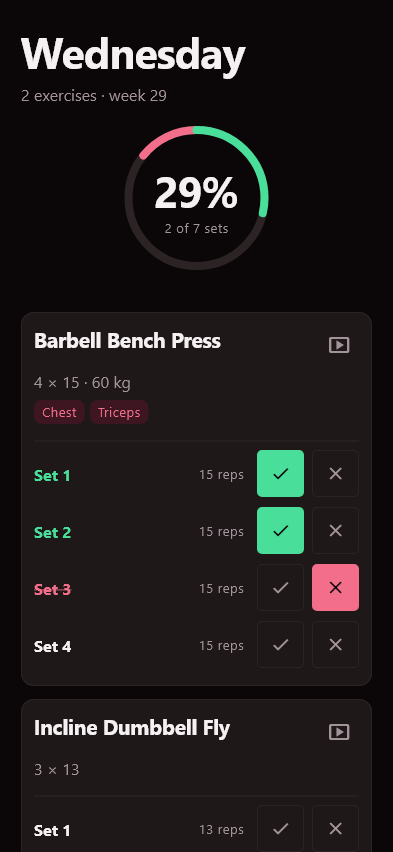
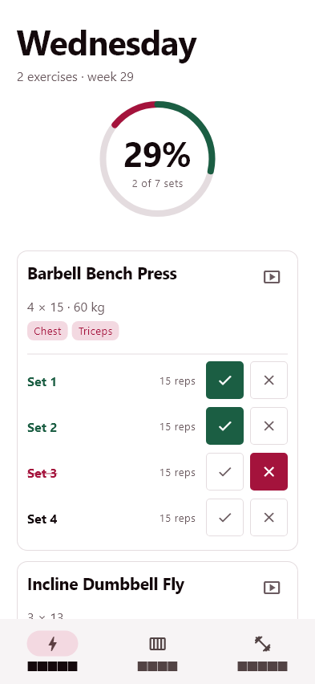
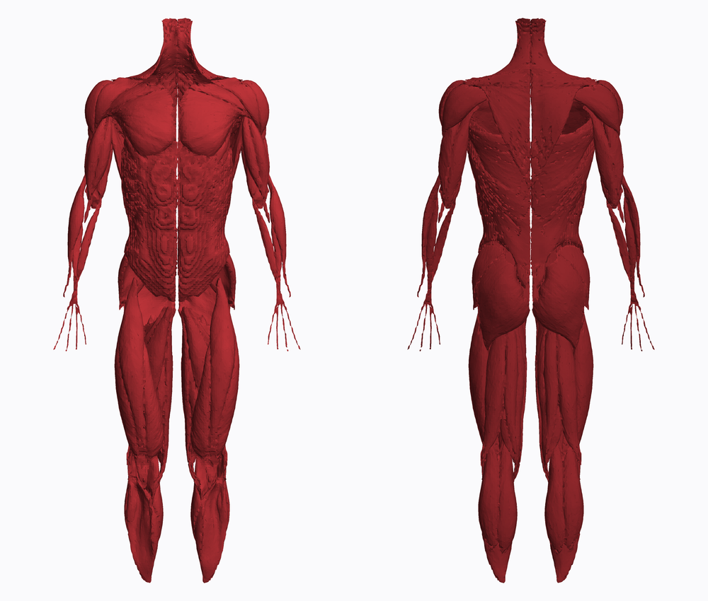

# Fitness Weekly Planner

A fully local, privacy-respecting weekly workout planner and execution tracker built with Flutter.

## Screenshots

<p align="center">
  
  
</p>

### 3D anatomy model (front and back)

<p align="center">
  
</p>

*Today (dark and light themes), drawn from the app's own widget tests with sample data. The 3D model is rendered from `assets/models/anatomy.glb`, which is derived from BodyParts3D (CC BY-SA 2.1 Japan, see `NOTICE.md`).*

## What it does

The app has three tabs:

- **Today** - the exercises planned for today, each with its sets. Mark every set as done or failed; a completion dial shows how much of the day is finished.
- **Plan** - build the week: pick a weekday, add exercises, and set the number of sets, reps and a load note (for example `4 x 15 - 60 kg`).
- **Moves** - your movement library. Each movement has a name, the muscles it trains (picked on a body map or a 3D anatomy model), and optional form videos.

Other things worth knowing:

- **Automatic weekly reset.** Progress is stored per ISO week, so every Monday 00:00 starts with a clean slate while all earlier weeks are kept for later analysis.
- **Form videos stay on the phone.** Videos you attach are copied into the app's private storage.
- **3D muscle picker.** Choose the muscles a movement trains on a 3D anatomy model (18 muscle groups) or a simple body map.
- **Fibonacci / golden-ratio design system.** Spacing, type sizes and the set stepper follow Fibonacci numbers and the golden ratio, in light and dark themes.

## How to use it

1. Open **Moves** and create a movement, choosing its muscles.
2. Open **Plan**, pick a day, tap **Add exercise**, choose the movement and set sets, reps and load.
3. On the training day open **Today** and tap the check or the cross after each set.
4. Watch the dial fill up; next Monday the week starts fresh.

## Privacy posture

- No analytics, no telemetry, no crash reporting, no ad SDKs.
- No network calls. All dependencies (`sqflite`, `path`, `path_provider`, `uuid`, `flutter_riverpod`, `image_picker`, `video_player`, `video_player_win`) operate offline. `video_player` only ever plays files from app-local storage; `image_picker` only reads what you explicitly select.
- Exercise form videos you attach are **copied into the app's private storage** (`<documents>/exercise_videos/`) and never leave the device.
- `google_fonts` is deliberately **not** used because it fetches font files over the network on first launch; the app relies on the platform sans-serif stack instead.
- All routines, exercises, video URIs, muscle selections, execution states, and journal notes live in a single on-device SQLite database.

## Architecture

Layered, with strict single-responsibility separation and dependency inversion:

```
lib/
  core/           design tokens (Fibonacci, golden ratio, palette, typography), time primitives
  domain/         entities + repository interfaces (no Flutter, no sqflite)
  data/           sqflite schema + repository implementations of the domain interfaces
  application/    Riverpod controllers (AsyncNotifier) + immutable view snapshots
  presentation/   widgets only — they read controllers, never touch repositories directly
```

- **Dependency inversion:** the `application` and `presentation` layers depend on abstract `RoutineRepository` / `ExecutionRepository` / `MuscleGroupRepository` interfaces in `domain`, not on sqflite. Tests substitute in-memory implementations through the same interfaces.
- **Reactive weekly reset:** execution state is keyed by an ISO-8601 `WeekStamp` (`2026-W29`). A new week is simply a key with no rows yet, so the slate resets automatically at Monday 00:00 local time while every prior week is retained for analytics.

## Project structure

```
lib/core/           design tokens, ISO-week math, clock
lib/domain/         entities and repository interfaces
lib/data/           SQLite schema, repositories, local video store
lib/application/    Riverpod controllers and view snapshots
lib/presentation/   screens and widgets (Today, Plan, Moves, anatomy)
tool/               script that builds the 3D anatomy model
test/               unit, database, widget and golden-image tests
```

## Running

- Mobile (the intended target): `flutter run` on an Android or iOS device.
- Desktop (used here for local verification): the database layer falls back to `sqflite_common_ffi`, so `flutter run -d windows` works too.

## Tests

```
flutter test
```

- `test/core/week_stamp_test.dart` — ISO week math checked against 58 ground-truth dates generated from Python's `isocalendar()`, including DST boundaries and 53-week years.
- `test/data/weekly_reset_test.dart` — real-SQLite integration proving reset semantics, foreign-key cascade, and history retention.
- `test/presentation/two_step_workflow_test.dart` — drives the full plan-then-execute UX against in-memory repositories.

## License

Free for personal, educational and research use. **Commercial use (selling, publishing the app in a store, or using it in a paid product) is not allowed without written permission.** See `LICENSE` (PolyForm Noncommercial 1.0.0). The 3D anatomy model is a separate work under CC BY-SA 2.1 Japan, see `NOTICE.md`.
