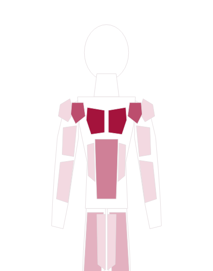

# Fitness Weekly Planner

A fully local, privacy-respecting weekly workout planner and execution tracker built with Flutter.

## Screenshots

  

## Privacy posture

- No analytics, no telemetry, no crash reporting, no ad SDKs.
- No network calls. All dependencies (`sqflite`, `path`, `path_provider`, `uuid`, `flutter_riverpod`, `image_picker`, `video_player`, `video_player_win`) operate offline. `video_player` only ever plays files from app-local storage; `image_picker` only reads what you explicitly select.
- Exercise form videos you attach are **copied into the app's private storage** (`<documents>/exercise_videos/`) and never leave the device.
- `google_fonts` is deliberately **not** used because it fetches font files over the network on first launch; the app relies on the platform sans-serif stack instead.
- All routines, exercises, video URIs, muscle selections, execution states, and journal notes live in a single on-device SQLite database.

## Architecture

Layered, with strict single-responsibility separation and dependency inversion:

```
lib/
  core/           design tokens (Fibonacci, golden ratio, palette, typography), time primitives
  domain/         entities + repository interfaces (no Flutter, no sqflite)
  data/           sqflite schema + repository implementations of the domain interfaces
  application/    Riverpod controllers (AsyncNotifier) + immutable view snapshots
  presentation/   widgets only — they read controllers, never touch repositories directly
```

- **Dependency inversion:** the `application` and `presentation` layers depend on abstract `RoutineRepository` / `ExecutionRepository` / `MuscleGroupRepository` interfaces in `domain`, not on sqflite. Tests substitute in-memory implementations through the same interfaces.
- **Reactive weekly reset:** execution state is keyed by an ISO-8601 `WeekStamp` (`2026-W29`). A new week is simply a key with no rows yet, so the slate resets automatically at Monday 00:00 local time while every prior week is retained for analytics.

## Running

- Mobile (the intended target): `flutter run` on an Android or iOS device.
- Desktop (used here for local verification): the database layer falls back to `sqflite_common_ffi`, so `flutter run -d windows` works too.

## Tests

```
flutter test
```

- `test/core/week_stamp_test.dart` — ISO week math checked against 58 ground-truth dates generated from Python's `isocalendar()`, including DST boundaries and 53-week years.
- `test/data/weekly_reset_test.dart` — real-SQLite integration proving reset semantics, foreign-key cascade, and history retention.
- `test/presentation/two_step_workflow_test.dart` — drives the full plan-then-execute UX against in-memory repositories.

## License

Code: MIT (see `LICENSE`). The 3D anatomy model is CC BY-SA 2.1 Japan, see `NOTICE.md`.
